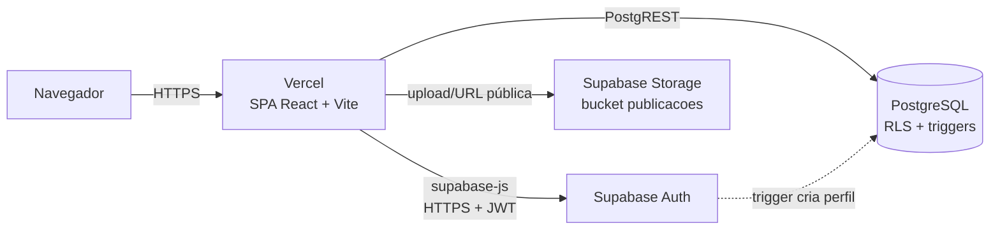

# 5. Plano de Desenvolvimento do MVP

Este documento transforma a documentação da Parte 2 (requisitos, regras, protótipos, ADRs e DER) em um plano de implementação e registra como cada item foi atendido no código em `app/` e `supabase/`.

## 5.1 Objetivo e escopo

Entregar uma aplicação web funcional de achados e perdidos que cubra integralmente as 10 histórias de usuário (HU01–HU10), as 12 regras de negócio (RN01–RN12) e os requisitos não funcionais verificáveis em ambiente de desenvolvimento.

**Dentro do escopo:** tudo o que está na seção "Escopo do MVP" do README.

**Fora do escopo (próximas versões):** chat interno, notificações por e-mail, exclusão de publicações, moderação/denúncia, recuperação de senha pela interface, login institucional (SSO), reabertura de publicação resolvida.

## 5.2 Arquitetura



A aplicação é uma SPA estática (ADR-001) hospedada na Vercel (ADR-003). Não há servidor próprio: o front-end conversa diretamente com o Supabase (ADR-002). Por isso as regras de segurança **não dependem do front-end** e estão no banco:

| Camada | O que garante |
|---|---|
| Front-end (`src/lib/validation.js`) | Feedback imediato, destaque de campos, validação de imagem antes do envio |
| Triggers PostgreSQL | RN04 (data futura), RN07 (nasce ATIVA), RN09 (tipo imutável), resolvida não pode ser editada |
| Constraints | RN02, RN03, RN07, RN10, RN11, RN12 |
| Row Level Security | RN01, RN06, RN08, RNF06; contato visível só para autenticados |
| Storage (bucket) | RN05/RNF12 no servidor: só JPG/PNG, até 5 MB, pasta por usuário |
| Supabase Auth | RNF05 (hash bcrypt), sessão JWT |

### Camada de dados com duas implementações

`src/services/api.js` expõe uma interface única (`signUp`, `listPublicacoes`, `resolverPublicacao` etc.) com duas implementações intercambiáveis:

- `supabaseBackend.js` — produção, usada quando `VITE_SUPABASE_URL` e `VITE_SUPABASE_ANON_KEY` estão definidas;
- `localBackend.js` — **modo demonstração**, com dados de exemplo no `localStorage`, que aplica as mesmas regras de negócio. Permite apresentar e testar o MVP sem nenhuma configuração.

As decisões complementares estão registradas no [ADR-004](adrs/ADR-004-roteamento-hash-e-modo-demonstracao.md).

## 5.3 Estrutura do código

```text
app/
├── index.html, vite.config.js, package.json, vercel.json, .env.example
├── src/
│   ├── main.jsx, App.jsx          # bootstrap e tabela de rotas
│   ├── styles.css                 # tokens de cor (claro/escuro), layout responsivo
│   ├── lib/
│   │   ├── validation.js          # regras de validação (funções puras, testadas)
│   │   ├── router.jsx             # roteador por hash, sem dependências
│   │   ├── image.js               # redimensionamento antes do upload
│   │   └── toast.js               # avisos de sucesso/erro
│   ├── services/                  # api.js, supabaseBackend.js, localBackend.js
│   ├── context/AuthContext.jsx    # sessão do usuário
│   ├── components/                # Header, PostCard, PostForm, Field, Badges, ConfirmDialog…
│   └── pages/                     # Home, Login, Signup, NewPost, EditPost, PostDetail, MyPosts
└── tests/validation.test.js       # 22 testes unitários (Vitest)
supabase/migrations/
├── 001_schema.sql                 # tabelas, índices, triggers, RLS, storage
└── 002_seed_categorias.sql        # categorias do DER
```

## 5.4 Plano de execução (iterações)

O trabalho foi dividido em quatro iterações curtas, cada uma terminando com algo demonstrável.

| Iteração | Entregas | Histórias | Pronto quando |
|---|---|---|---|
| **1 — Fundação** | Projeto Vite, roteamento, layout, tokens visuais, migração do banco, RLS, bucket | — | App abre em 360–1440 px; migração roda sem erro no Supabase |
| **2 — Contas** | Cadastro com telefone, login, logout, rotas protegidas | HU01, HU02 | E-mail duplicado bloqueado; erro de login genérico |
| **3 — Publicar e consultar** | Formulário compartilhado, upload de imagem, listagem, busca, filtros, paginação, detalhes, contato | HU03–HU07 | Data futura e imagem inválida recusadas; resolvidas fora da lista |
| **4 — Gestão do autor e qualidade** | Edição com tipo bloqueado, marcar como resolvida, minhas publicações, testes, acessibilidade, deploy | HU08–HU10 | Todos os critérios de aceite verificados; deploy na Vercel |

### Definition of Done

Uma história só é considerada concluída quando: (1) todos os seus critérios de aceite passam; (2) a regra de negócio relacionada é garantida também no banco, quando aplicável; (3) a tela funciona a 360 px sem rolagem horizontal; (4) campos têm rótulo, erros são anunciados e o foco vai ao primeiro campo inválido; (5) os testes unitários passam.

## 5.5 Rastreabilidade: história → implementação

| HU | Onde está | Regras garantidas |
|---|---|---|
| HU01 Criar conta | `pages/Signup.jsx`, trigger `handle_new_user` | RN11 (e-mail único no Auth + `unique`), RN12 (telefone com DDD, `check`) |
| HU02 Entrar/sair | `pages/Login.jsx`, `components/Header.jsx` | Mensagem genérica "E-mail ou senha inválidos." |
| HU03/HU04 Publicar | `pages/NewPost.jsx`, `components/PostForm.jsx` | RN02, RN03, RN04, RN05 no front e no banco |
| HU05 Consultar | `pages/Home.jsx` | RN08 via RLS + filtro `status = 'ATIVA'`; ordem do mais recente |
| HU06 Pesquisar/filtrar | `pages/Home.jsx`, `listPublicacoes` | Busca em título e descrição, índices trigram (RNF02) |
| HU07 Detalhes e contato | `pages/PostDetail.jsx` | Contato só para autenticados; atalhos de telefone, e-mail e WhatsApp |
| HU08 Editar | `pages/EditPost.jsx` | RN06 (RLS + checagem na tela), RN09 (tipo bloqueado + trigger) |
| HU09 Resolver | `PostDetail.jsx`, `MyPosts.jsx` | Confirmação antes de encerrar; RN07 |
| HU10 Minhas publicações | `pages/MyPosts.jsx` | Somente do autor; abas Todas/Ativas/Resolvidas com status visual |

## 5.6 Verificação dos requisitos não funcionais

| RNF | Como foi atendido | Como medir |
|---|---|---|
| RNF01 Carregamento ≤ 2 s | Bundle único sem bibliotecas de UI; paginação de 12 itens | Lighthouse / aba Network no deploy |
| RNF02 Busca ≤ 2 s em 10 mil | Índices `pg_trgm` em título e descrição; índice `(status, criado_em)` | Inserir 10 mil linhas de teste e cronometrar a busca |
| RNF03 Disponibilidade 99,5% | SLA das plataformas Vercel e Supabase | Painéis de status das plataformas |
| RNF04 HTTPS | Vercel força HTTPS; cabeçalho HSTS em `vercel.json` | Acessar via `http://` e verificar o redirecionamento |
| RNF05 Senhas com hash | Supabase Auth (bcrypt); a tabela `usuario` não tem senha | Inspecionar o schema |
| RNF06 Sessão validada | RLS em 100% das escritas; `auth.getUser()` antes de gravar | Tentar `update` via API com outro usuário (deve falhar) |
| RNF07 Publicar em ≤ 3 min | Formulário de uma tela, foco no primeiro erro, dicas nos campos | Teste com 3 colegas cronometrados |
| RNF08 360–1440 px | Grid fluido, navegação compacta no celular | Verificado automaticamente nas telas principais |
| RNF09 Navegadores | Apenas APIs suportadas por Chrome, Edge e Firefox atuais | Teste manual nos três |
| RNF10 Contraste 4,5:1 | Todos os pares de texto/fundo calculados ≥ 5,7:1 (claro e escuro) | Ferramenta de contraste do DevTools |
| RNF11 Integridade | Chaves estrangeiras `not null`; autor imutável (trigger) | Schema + tentativa de alterar `usuario_id` |
| RNF12 Imagem | Validação antes do envio + limites do bucket no servidor | Enviar `.gif` e arquivo de 6 MB |

## 5.7 Testes

**Unitários (Vitest)** — `app/tests/validation.test.js`, 22 casos cobrindo RN02–RN05, RN09, RN12 e utilitários. Executar com `npm test`.

**Critérios de aceite (fim a fim)** — os fluxos abaixo foram executados em navegador automatizado no modo demonstração e passaram:

1. Listagem inicial mostra só ativas (a resolvida de exemplo não aparece).
2. Busca por "chave" retorna 1 resultado; filtro "Encontrado" retorna 3; combinação sem resultados exibe "Nenhum resultado encontrado".
3. Detalhes sem login pedem para entrar antes de mostrar o contato.
4. Acessar "Nova publicação" sem login redireciona para Entrar e volta depois.
5. Senha errada mostra erro genérico.
6. Cadastro vazio destaca campos; e-mail já usado é recusado; cadastro válido entra direto.
7. Publicação vazia é bloqueada; data futura, `.gif` e arquivo acima de 5 MB são recusados.
8. Publicação com foto PNG é criada e a foto aparece nos detalhes.
9. Na edição o tipo está bloqueado; alteração de título é salva.
10. Usuário que não é autor não vê "Editar" e não consegue editar pelo endereço direto.
11. "Minhas publicações" mostra só as do usuário; marcar como resolvida remove da listagem pública.
12. Nenhuma das telas principais tem rolagem horizontal a 360 px.

**Segurança no Supabase (manual, após o deploy)** — com dois usuários A e B: B tenta `update` em publicação de A pela API (deve retornar 0 linhas); usuário anônimo consulta `usuario` (deve retornar vazio); upload na pasta de outro usuário (deve falhar).

## 5.8 Riscos e mitigação

| Risco | Mitigação |
|---|---|
| Exposição de contato pessoal | Contato só para autenticados; aviso no cadastro de que telefone e e-mail ficam visíveis a usuários cadastrados |
| Publicações falsas ou spam | Fora do escopo; próximo passo é restringir cadastro a e-mails institucionais e adicionar denúncia |
| Limites do plano gratuito (Supabase/Vercel) | Imagens reduzidas para no máx. 1600 px antes do upload |
| Projeto Supabase gratuito pausa por inatividade | Acessar o painel antes da apresentação |
| Confirmação de e-mail ativa por padrão no Supabase | A tela de cadastro trata os dois cenários (com e sem confirmação) |

## 5.9 Próximos passos sugeridos

Restringir cadastro ao domínio de e-mail da universidade; reabrir publicação resolvida por engano; botão de denúncia; recuperação de senha; notificação quando surgir uma publicação "Encontrado" compatível com uma "Perdido" (mesma categoria e palavras do título).
